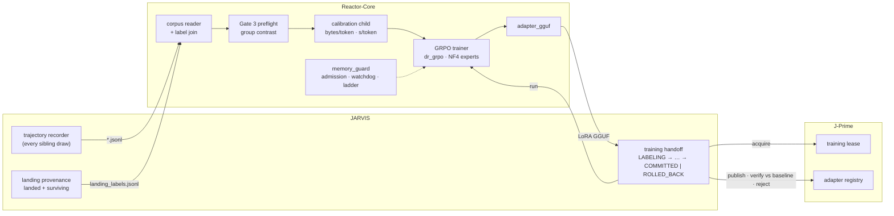

# Reactor-Core

**The training tier of the Trinity autonomous multi-agent OS. It fine-tunes a 30.5B-parameter MoE coder with GRPO on a single 32 GB RTX 5090, using reward signal from the system's own verified commits: per-expert NF4 quantization, attention-only LoRA, and a memory envelope calibrated from measurement rather than guessed.**

Reactor-Core is one of three repositories, all solo-architected by [Derek J. Russell](https://github.com/drussell23): **5.35M tracked lines** (4.13M Python), **11,250+ commits**, and **66,900+ `def test_` functions**.

| Repository | Tier | Role |
|---|---|---|
| [**JARVIS**](https://github.com/drussell23/JARVIS) | Agent OS / control plane | The Ouroboros + Venom (O+V) autonomous engineering pipeline. It records trajectories, proves which candidates landed, and orchestrates each training cycle. |
| [**J-Prime**](https://github.com/drussell23/JARVIS-Prime) | Inference serving | Serves the model; hands the GPU to training under an exclusive lease; publishes and rolls back adapters |
| **Reactor-Core** (this repo) | Training | Corpus gating, GRPO training, memory safety, adapter conversion |

---

## At a glance

| | |
|---|---|
| Model trained | `Qwen/Qwen3-Coder-30B-A3B-Instruct`: 30.5B MoE (128 experts, 8 active), from bf16 base weights (56.9 GiB on disk) |
| Resident after load | **15.64 GiB** with per-expert NF4 + double quantization |
| Trainable parameters | **13.4M** LoRA over 192 attention projections, a **~27 MB** adapter. Adapting the experts instead would mean ~830M parameters and ~11.8 GiB of adapter + optimizer state. |
| Decode during rollouts | **0.80 s/token** with the KV cache vs 2.8 s/token without |
| Completion window | Calibrated per run from measured bytes/token and seconds/token. Example: **1,955 tokens** for a 4,096-token prompt at a group size of 16, bound by generation memory (`1041a78`) |
| Failure containment | Every memory rung runs in its own subprocess; a host-commit watchdog kills the trainer before Windows or WSL can crash |
| Tests | 46 files, 618 test functions (training stack: 23 files, 329 functions) |

---

## Where it sits in the loop



JARVIS's `training_handoff` drives each cycle. It acquires J-Prime's lease (the engine drains and frees verified VRAM), runs `scripts/run_grpo_training.py`, converts the adapter with `adapter_gguf.py`, and publishes it to J-Prime's registry. The new adapter stays live only if it beats the incumbent on a greedy, prompt-cache-off comparison. Otherwise it is rejected and the last good version is restored.

---

## Training data: rewards from what actually shipped

| Stage | Implementation | What it guarantees |
|---|---|---|
| Corpus reader | `training/grpo_pipeline.py` | Reads recorder `interaction` rows, deduplicated on `(op_id, candidate_hash)`. Keeps only genuine draws; retries are dropped unless they are no-ops. Undecodable lines are counted, never silently dropped. |
| Provenance join | same, single reader | Landing labels come from a hash-chained ledger, and a chain break stops the read. `landed ∧ surviving` → `outcome=success, confidence=1.0`. Preflight, dataset, and runner all see the same truth. |
| Gate 3 preflight | `scripts/grpo_preflight.py` | Groups rows by task and keeps only groups whose grades actually differ. Too few trainable groups → exit 2 (refuse). |
| Dataset validation | `training/grpo_pipeline.py` | Rejects reference-answer leakage columns, blank prompts, and duplicate prompts |
| Reward | `training/grpo_reward.py`, `training/grpo_verifier.py` | Tiered grading: envelope 0.10 → shape 0.25 → syntax 0.45 → pass ≥ 0.60 → authority 1.0. Bands are enforced as monotonic. Within a group, task intent and a differential footprint refine the grade. A flat group returns `None` so TRL drops it instead of training on noise. |

**GRPO configuration:** `loss_type="dr_grpo"`, `beta=0` (no reference model held in memory), `num_iterations=2`, `epsilon_high=0.28`, `scale_rewards=False`, `mask_truncated_completions=True`. A truncation guard stops the run after two consecutive steps where every completion was clipped. The system **never trains on truncated answers**.

---

## Memory engineering on one 32 GB card

| Mechanism | Implementation | Purpose |
|---|---|---|
| Per-expert NF4 | `training/moe_quant.py` | Quantizes each fused 3-D expert tensor expert by expert. Stock bitsandbytes left 29.0B of 30.5B parameters in bf16 (~54 GiB). The quantizer raises if any expert stays bf16. |
| Admission | `training/memory_guard.py` | Refuses to start above 55% VRAM occupancy, below 12 GiB host `MemAvailable`, or below 16 GiB Windows commit headroom under WSL. Unreadable probes → refuse. |
| Watchdog | same | Soft trip at 99% VRAM or < 4 GiB host memory stops training at a step boundary. Below 14 GiB of host commit, it SIGKILLs itself before the VM can take the desktop down. |
| Allocator cap | same | `set_per_process_memory_fraction(0.95)`, so CUDA raises OOM instead of spilling into host RAM. Sysmem fallback once let torch report 61.75 GiB "allocated" on a 32 GiB card. |
| Page-cache valve | same | `MADV_PAGEOUT` + `POSIX_FADV_DONTNEED` on checkpoint shards during load |
| Rung ladder | same + `scripts/run_grpo_training.py` | As-configured → ½ completion → ¼ completion → ½ group size. Each rung runs in a fresh subprocess, so a failed rung cannot fragment the next one's allocator. |
| Calibration | `scripts/run_grpo_training.py`, `memory_guard.fit_completion_window` | Measures generation, activation, and logit bytes/token plus decode seconds/token at two contexts. It mirrors the Trainer's own gradient-checkpointing setup, then solves for `--max-completion-length` and `--max-steps` within the time budget. |
| Deadline | `_DeadlineCallback` | Stops at a step boundary before the time budget runs out, so the adapter is always saved |

---

## Local setup

**Requirements:** Linux or WSL2 · Python 3.11 · NVIDIA GPU with ≥ 32 GB VRAM (Blackwell `sm_120` needs a cu128 PyTorch build) · verified stack **transformers 5.16.1, trl 1.12.0** (the `pyproject.toml` floors are looser than what the GRPO path requires) · llama.cpp checkout + `gguf` for adapter conversion.

```bash
python3.11 -m venv ~/.venvs/reactor-train && source ~/.venvs/reactor-train/bin/activate
pip install torch --index-url https://download.pytorch.org/whl/cu128
pip install -e ".[server]" "transformers==5.16.1" "trl==1.12.0" peft bitsandbytes accelerate
```

**Gate the corpus, then train:**

```bash
export REACTOR_TRAINING_STRATEGY=grpo           # the default trainer is still SFT
python scripts/grpo_preflight.py --telemetry-dir ~/.jarvis/trinity/events
python scripts/run_grpo_training.py \
  --model Qwen/Qwen3-Coder-30B-A3B-Instruct \
  --telemetry-dir ~/.jarvis/trinity/events \
  --time-budget-s 21600                          # --max-completion-length defaults to auto (calibrated)
```

Exit codes: `0` ok · `1` error · `2` refused (corpus or hardware gate) · `3` every rung out of memory · `4` a child rung out of memory.

**Convert the adapter for J-Prime:**

```bash
python reactor_core/quantization/adapter_gguf.py <adapter-dir> adapter.gguf   # prints one JSON result
```

**Run the API server** (live experience ingestion on loopback `:8090`):

```bash
scripts/host/reactor_core.sh start      # start | stop | status
curl -s http://127.0.0.1:8090/health
```

The receiver tails `experience_*.jsonl` non-destructively, keeping a byte offset per file. It does not train automatically; cycles are started by JARVIS's training handoff.

**Windows hosts:** `scripts/host/set_pagefile_commit_headroom.ps1` (admin) raises the commit limit. `scripts/host/nv_sysmem_fallback.ps1` reads or sets the NVIDIA CUDA sysmem-fallback policy, so the card fails with a clear OOM instead of slowing down silently.

---

## Testing

```bash
pytest                    # all suites
pytest tests/training     # GRPO, reward, verifier, memory guard, calibration
```

The training-stack tests need no model weights. Tests that require CUDA (bitsandbytes NF4, expert autograd) are marked `skipif`, and suites that need optional ML dependencies use `importorskip` instead of erroring at collection. Compare collected counts when moving between hosts.

---

## Repository layout

| Path | Status |
|---|---|
| `reactor_core/training/`, `scripts/run_grpo_training.py`, `scripts/grpo_preflight.py`, `reactor_core/quantization/adapter_gguf.py`, `scripts/host/` | **Current GRPO path** |
| `reactor_core/api/`, `reactor_core/integration/trinity_experience_receiver.py` | Active: API server and live ingestion |
| `reactor_core/orchestration/`, `reactor_core/deployment/` | Night-shift SFT/DPO pipeline and Ollama-based deploy (pre-GRPO) |
| `mlforge/`, `bindings/`, `CMakeLists.txt`, root `*_V8x.md` notes | Earlier C++ bindings and design notes; not on the training path |

---

## License

MIT. See [`LICENSE`](LICENSE).
